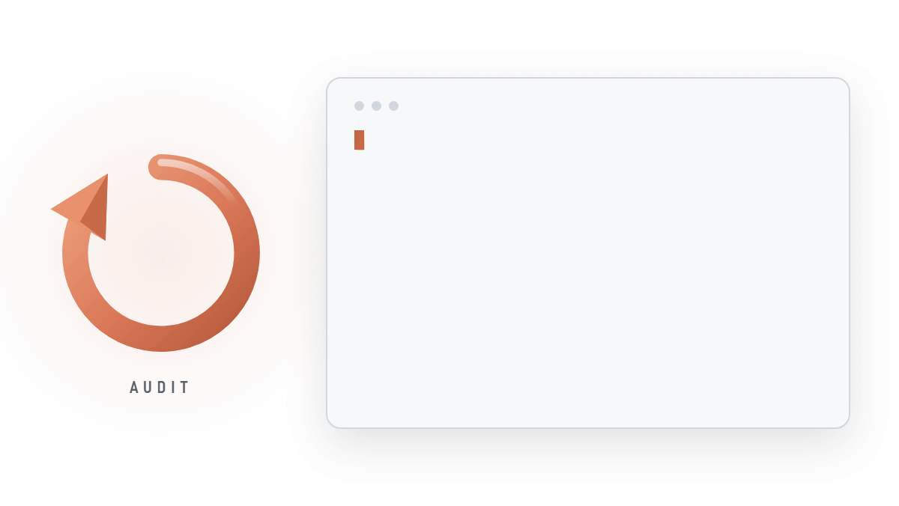
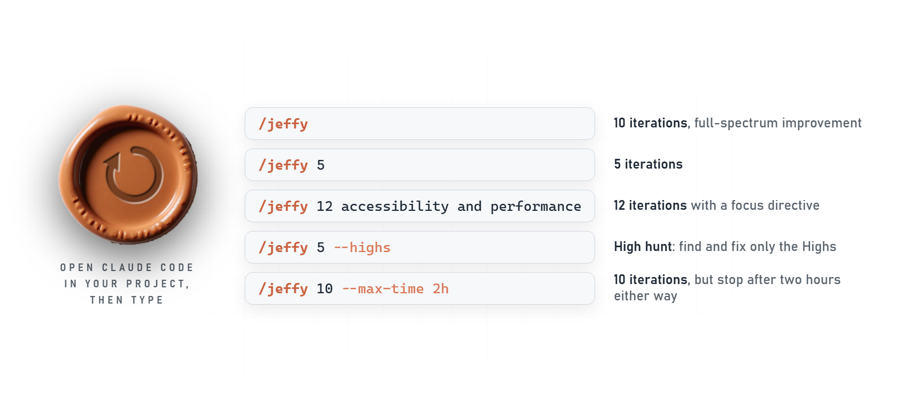

<div align="center">

<picture>
  <source media="(prefers-color-scheme: dark)" srcset="media/wordmark-dark.png">
  
</picture>

[](https://github.com/lenamonj/jeffy-loop/actions/workflows/validate.yml)
[%20behavioural%20checks&replace=%241%2B%20per%20host&label=behavioural%20checks&style=for-the-badge&color=22C55E)](scripts/validate.sh)
[](https://claude.com/claude-code)

[](LICENSE)

**[Quick Install](#quick-install)** &nbsp;·&nbsp; **[Usage](docs/usage.md)** &nbsp;·&nbsp; **[How it works](docs/how-it-works.md)** &nbsp;·&nbsp; **[The receipts](evals/README.md)** &nbsp;·&nbsp; **[Headless](docs/headless.md)** &nbsp;·&nbsp; **[White paper](https://github.com/lenamonj/jeffy-loop/raw/main/The-Jeffy-Loop.pdf)** &nbsp;·&nbsp; **[STE100 description](https://github.com/lenamonj/jeffy-loop/raw/main/Jeffy-Loop-STE100.pdf)**

## A Claude Code loop that finds bugs in your repo, fixes them, and proves every fix before it commits. Maintainers have merged <!-- count:merged -->70<!-- /count --> of its patches.

</div>

The model writes the patch. The harness around it decides whether that patch can be trusted. Jeffy Loop is a verification harness for Claude Code: type `/jeffy` and it audits your codebase, finds a problem, fixes it, checks the fix, and commits the result locally, one task at a time. It keeps going until the codebase passes a fresh audit.

The harness is deliberately hard to fool. If a fix breaks your tests, it is undone. Nothing is ever pushed. A standard run counts as complete only when a fresh audit is clean, your tests pass again, and an adversarial review by a second AI agent with no part in the run signs off. The goal is fixes that survive scrutiny.

There is a real-world test for that. Maintainers with no stake in this project have merged <!-- count:merged -->70<!-- /count --> of its pull requests, each filed from a local clone, into projects run by NVIDIA, Arm, Meta, Tesla, Google, Apple, Microsoft, Netflix, Apache, Palo Alto Networks, Oracle, IBM, HashiCorp, Cisco, Uber, Square, Cloudflare, and more. [See them all.](#independent-validation---the-receipts)

<div align="center">

<picture>
  <source media="(prefers-color-scheme: dark)" srcset="media/how-it-works.gif">
  
</picture>

</div>

## The record

Jeffy was run against <!-- count:tested -->132<!-- /count --> open-source projects with no connection to this repository, each judged by its own test suite. Every run is published, failures included.

| Projects tested | Converged | Failed | PRs merged | PRs open | Issues filed |
|:---:|:---:|:---:|:---:|:---:|:---:|
| **<!-- count:tested -->132<!-- /count -->** | **<!-- count:converged -->103<!-- /count -->** | **<!-- count:failed -->28<!-- /count -->** | **<!-- count:merged -->70<!-- /count -->** | **<!-- count:prs-open -->17<!-- /count -->** | **<!-- count:issues -->4<!-- /count -->** |

**Converged:** the closing audit came back clean and the loop's adversarial evaluator, a fresh-context sub-agent, countersigned it, a standard this repository set and checks itself. That happened in <!-- count:converged -->103<!-- /count --> projects across <!-- count:languages -->13<!-- /count --> languages with no language-specific analyzer. **Failed:** the run spent the budget declared before it started without converging, or, for libuv, was abandoned before it had one. That leaves PapaParse, an audit held to the same method rather than a loop run, which the receipts page counts as Fixed alongside the 103.

**[See every project, every patch, and every failure](evals/README.md)**

## Quick Install

You need [Claude Code](https://claude.com/claude-code), signed in once, and [git](https://git-scm.com/downloads). Each installer checks for everything else and asks before installing `jq`.

### Install Jeffy with pip

**Step 1.** Install the package.

```bash
pip install jeffy-loop
```

**Step 2.** Install Jeffy as a Claude Code skill.

```bash
jeffy install
```

---

### Install Jeffy with uv

You need [uv](https://docs.astral.sh/uv/getting-started/installation/). If you do not have it, `pip install uv` gets it.

**Step 1.** Install the package.

```bash
uv tool install jeffy-loop
```

**Step 2.** Install Jeffy as a Claude Code skill.

```bash
jeffy install
```

---

### Install Jeffy by cloning the repo locally

**Mac and Linux**

```bash
git clone https://github.com/lenamonj/jeffy-loop.git
cd jeffy-loop
./install.sh
```

**Windows PowerShell**

```powershell
git clone https://github.com/lenamonj/jeffy-loop.git
cd jeffy-loop
powershell -ExecutionPolicy Bypass -File .\install.ps1
```

The `-ExecutionPolicy Bypass` form runs the installer on a machine where PowerShell scripts are disabled by default and changes no policy.

## Running Jeffy

Open Claude Code in the project you want to improve and type `/jeffy 10` into the session.

<div align="center">

<picture>
  <source media="(prefers-color-scheme: dark)" srcset="media/running-jeffy.png">
  
</picture>

</div>

Start a new session for each run, [so each run reads its state files with a clean context](docs/usage.md#use-several-short-runs-not-one-long-one).

A High hunt fixes only the Highs and stops at the first audit that finds none, so it is usually the faster run.

[Usage](docs/usage.md) covers every flag.

## What the engine enforces

Each rule is enforced by the iteration prompt, the state files or the Stop hook, and each can be checked in this repository. [How.](docs/how-it-works.md#what-the-engine-enforces)

| Rule | What it means |
|:---|:---|
| **A finding needs proof** | The loop must point at the defect and prove it with a check that runs. |
| **Three gates decide done** | A fresh audit with no High or Medium findings, an adversarial evaluator's countersignature, and a shell re-run of your tests. In one greenfield build the evaluator was invoked 8 times and rejected 7. A High hunt skips the evaluator and never claims convergence. |
| **No convergence over unswept surface** | The Stop hook refuses to converge while any row of the public-surface checklist is unswept, and a row reopens when its code changes. |
| **Lessons become checks** | A rule learned once binds every later iteration. The engine passes at least <!-- count:checks -->**477 behavioural checks**<!-- /count --> on each of Linux, Windows and macOS. [How the loop improves itself.](docs/how-it-works.md#the-loop-improves-the-loop) |

###  Trust model

| Question | Answer |
|:---|:---|
| **What runs** | One Stop hook, `skills/jeffy/hooks/stop-hook.sh`, plus the small library beside it in `skills/jeffy/hooks/lib/`. With no live Jeffy state file it exits at once and does nothing. |
| **What it can touch** | The loop acts through your Claude Code session with that session's permissions. Its no-push rule lives in the iteration prompt, so never allowlist push or force operations for it. [Usage](docs/usage.md#good-to-know), [Blast radius](SECURITY.md#blast-radius). |
| **What the installer writes** | Two skill folders under `~/.claude/skills` and one hook entry in `~/.claude/settings.json`. [Upgrading and removing them.](docs/usage.md#already-installed-upgrade) |
| **How to stop it** | `/cancel-jeffy` ends a run at any time. |

---

<div align="center">


</div>

## Independent Validation - The Receipts

Each finding below was accepted upstream by the project's own maintainers.

<table>
  <tr>
    <th align="left">Merged by</th>
    <th align="left">Finding</th>
  </tr>
  <tr>
    <td> NVIDIA</td>
    <td><a href="https://github.com/NVIDIA/go-nvml/pull/207">go-nvml #207</a> - merged in 12 days<br>The buffer handed to <code>dlinfo</code> for a library's directory was allocated with zero bytes, so the first <code>Path()</code> on a library opened by soname wrote past it and the next <code>dlclose</code> crashed<br><br><a href="https://github.com/NVIDIA/k8s-device-plugin/pull/2002">k8s-device-plugin #2002</a> - merged in 13 days<br>An empty <code>deviceListStrategy</code> list in the config file passed validation, and the container started with no GPU access and no error<br><br><a href="https://github.com/NVIDIA/nvidia-container-toolkit/pull/2108">nvidia-container-toolkit #2108</a> - merged in 11 days<br>A GPU id repeated in the visible devices request left an empty device in the list, and in CDI mode the container failed to start with an unresolvable device<br><br><a href="https://github.com/NVIDIA/go-nvml/pull/206">go-nvml #206</a> - merged in 30 days<br><code>Shutdown()</code> called <code>nvmlShutdown()</code> whether or not the library had loaded, so on a host without <code>libnvidia-ml.so.1</code> the shutdown paired with a failed <code>Init()</code> took the process down with a symbol lookup error instead of returning <code>ERROR_UNINITIALIZED</code></td>
  </tr>
  <tr>
    <td> Arm</td>
    <td><a href="https://github.com/ARM-software/astc-encoder/pull/668">astc-encoder #668</a> - merged in 28 days<br>On F16C builds <code>float16_to_float(vint4)</code> packed the half-float codes with signed saturation, so every negative half decoded as NaN and a half-float normal map compressed differently on AVX2 than on SSE4.1</td>
  </tr>
  <tr>
    <td> Meta</td>
    <td><a href="https://github.com/facebook/stylex/pull/1850">stylex #1850</a> - merged in 17 days<br><code>stylex.positionTry</code> emitted every declaration twice, one of them with the property name as its own value, and an RTL variant for every rule<br><br><a href="https://github.com/facebook/stylex/pull/1849">stylex #1849</a> - merged in 17 days<br>Configuring a custom <code>importSources</code> on the rollup plugin or unplugin narrowed the compile gate, so ordinary <code>@stylexjs/stylex</code> modules stopped reaching the compiler and the custom source was never transformed</td>
  </tr>
  <tr>
    <td> Tesla</td>
    <td><a href="https://github.com/teslamotors/vehicle-command/pull/479">vehicle-command #479</a> - merged in 15 days<br>The proxy read every client request body with no size limit, so any client that reached the listener could drive memory allocation without bound</td>
  </tr>
  <tr>
    <td> Google</td>
    <td><a href="https://github.com/google/snappy/pull/257">snappy #257</a> - merged in 1 day<br>Every release build compressed a 4 GiB input into a stream whose header claimed 0 bytes<br><br><a href="https://github.com/google/benchmark/pull/2294">benchmark #2294</a> - merged in 7 days<br>The complexity report gave its BigO coefficient in nanoseconds whatever time unit the benchmark declared<br><br><a href="https://github.com/google/brotli/pull/1537">brotli #1537</a> - merged in 45 days<br><code>brotli --rm</code> deleted its input and exited 0 after the output write had failed, because the only flush sat in a metadata copy whose failure returned silently; the close now flushes, reports the failure and keeps the input</td>
  </tr>
  <tr>
    <td> Apple</td>
    <td><a href="https://github.com/apple/swift-log/pull/504">swift-log #504</a> - merged in 2 days<br>A documented no-op setter asserted instead<br><br><a href="https://github.com/apple/swift-log/pull/503">swift-log #503</a> - merged in 5 days<br>A handler implementing only <code>log(event:)</code> overflowed the stack on the SwiftLog 1.0 entry point<br><br><a href="https://github.com/apple/swift-protobuf/pull/2164">swift-protobuf #2164</a> - merged in 15 hours<br>The project's own CMake build of <code>protoc-gen-swift</code> had not compiled since June<br><br><a href="https://github.com/swiftlang/swift-format/pull/1286">swift-format #1286</a> - merged in 4 days<br>Formatting in place replaced the file, so a 0600 source came back 0644 and a read-only one lost its bit<br><br><a href="https://github.com/apple/swift-metrics/pull/244">swift-metrics #244</a> - merged in 4 days<br>The package's own test kit crashed on a repeated dimension name<br><br><a href="https://github.com/apple/swift-certificates/pull/317">swift-certificates #317</a> - merged in 16 days<br>A <code>/0</code> iPAddress name constraint matched nothing, so a CA barred from every IP address by <code>0.0.0.0/0</code> and <code>::/0</code> exclusions still verified a leaf with an IP SAN</td>
  </tr>
  <tr>
    <td> Microsoft</td>
    <td><a href="https://github.com/microsoft/mimalloc/pull/1385">mimalloc #1385</a> - merged in 8 hours<br>The zeroing allocator returned uninitialized memory above the small-size threshold<br><br><a href="https://github.com/microsoft/snmalloc/pull/878">snmalloc #878</a> - merged in 2 hours<br>The header-only build recipe named a CMake target removed in 2021 and include paths that resolved nowhere<br><br><a href="https://github.com/microsoft/GSL/pull/1271">GSL #1271</a> - merged in 4 days<br>The documented conversion from an iterator to its <code>const_iterator</code> was an access error at every use<br><br><a href="https://github.com/microsoft/GSL/pull/1272">GSL #1272</a> - merged in 9 days<br><code>dyn_array_iterator</code> declared random access but had no relational operators, no <code>-&gt;</code> and no <code>n + it</code>, so <code>std::sort</code> over a <code>dyn_array</code> did not compile</td>
  </tr>
  <tr>
    <td> Netflix</td>
    <td><a href="https://github.com/Netflix/zuul/pull/2213">zuul #2213</a> - merged in 17 days<br><code>HttpQueryParams.get</code> lower-cased the lookup key against names stored verbatim, so every query parameter with an uppercase letter in its name came back empty</td>
  </tr>
  <tr>
    <td> Apache</td>
    <td><a href="https://github.com/apache/commons-text/pull/768">commons-text #768</a> - merged in 2 days<br>A <code>StringMatcher</code> overload forwarded the buffer end as its start<br><br><a href="https://github.com/apache/commons-csv/pull/633">commons-csv #633</a> - merged in 3 days<br>The record counter's Javadoc said headers were not counted while the constructor's header was<br><br><a href="https://github.com/apache/commons-lang/pull/1784">commons-lang #1784</a> - merged in 1 day<br><code>Fraction.add</code> and <code>subtract</code> overflowed on operands not in lowest terms, or returned them unreduced<br><br><a href="https://github.com/apache/commons-lang/pull/1783">commons-lang #1783</a> - merged in 1 day<br><code>MethodUtils.invokeMethod</code> threw on an instance of any non-public class, every JDK collection factory result included<br><br><a href="https://github.com/apache/commons-lang/pull/1787">commons-lang #1787</a> - merged in 6 hours<br><code>Fraction</code>'s zero shortcuts returned the other operand unreduced, and threw where the reduced result fits<br><br><a href="https://github.com/apache/commons-codec/pull/443">commons-codec #443</a> - merged in 9 days<br>The Git tree-id builder sorted entries by UTF-16 code units where Git sorts UTF-8 bytes, so a name outside the Basic Multilingual Plane gave a different id from <code>git write-tree</code><br><br><a href="https://github.com/apache/commons-io/pull/875">commons-io #875</a> - merged in 48 days<br><code>MemoryMappedFileInputStream.read()</code> returned 0xFF80 to 0xFFFF for every byte from 0x80 to 0xFF, outside the 0 to 255 that the <code>InputStream.read()</code> contract promises<br><br><a href="https://github.com/apache/commons-io/pull/877">commons-io #877</a> - merged in 48 days<br><code>FileWriterWithEncoding.Builder</code> seeded its encoder from the default Charset and <code>get()</code> threw when the Charset and the encoder disagreed, so the builder could write nothing but the platform default encoding</td>
  </tr>
  <tr>
    <td> Palo Alto Networks</td>
    <td><a href="https://github.com/PaloAltoNetworks/docusaurus-openapi-docs/pull/1625">docusaurus-openapi-docs #1625</a> - merged in 31 days<br>A query or header parameter declared <code>explode: true</code> with a scalar value was enumerated as an object, so <code>status=available</code> went out as <code>status=</code> in the API explorer request and its code snippet, and a <code>null</code> header threw<br><br><a href="https://github.com/PaloAltoNetworks/docusaurus-openapi-docs/pull/1624">docusaurus-openapi-docs #1624</a> - merged in 31 days<br><code>clean-api-docs</code> deleted every <code>*.json</code> in the output directory and all of <code>schemas/</code>, so a hand-authored <code>_category_.json</code> went with the generated files<br><br><a href="https://github.com/PaloAltoNetworks/docusaurus-openapi-docs/pull/1626">docusaurus-openapi-docs #1626</a> - merged in 31 days<br>Every copy of the docs spelled the credential-persistence option <code>authPersistance</code> while the theme reads <code>authPersistence</code>, so a site set to <code>false</code> still wrote reader API keys and passwords to <code>sessionStorage</code></td>
  </tr>
  <tr>
    <td> Oracle</td>
    <td><a href="https://github.com/oracle/macaron/pull/1466">macaron #1466</a> - merged in 3 days<br>The build spec dropped the JDK version read from the JAR whenever the artifact recorded no language version</td>
  </tr>
  <tr>
    <td> IBM</td>
    <td><a href="https://github.com/IBM/sarama/pull/3740">sarama #3740</a> - merged in 14 days<br>The round-robin balancer never returned when the topics map held a topic no consumer group member subscribed to<br><br><a href="https://github.com/IBM/fp-go/pull/236">fp-go #236</a> - merged in 10 hours<br>A provider graph that referred back to itself deadlocked the dependency injector forever with no diagnostic; it now reports the chain that closes the circle</td>
  </tr>
  <tr>
    <td> HashiCorp</td>
    <td><a href="https://github.com/hashicorp/hcl/pull/841">hcl #841</a> - merged in 18 days<br>hclwrite's <code>Expression.Variables</code> returned nothing for an object value and <code>RenameVariablePrefix</code> left its references untouched, so a rename tool silently missed every variable inside an object</td>
  </tr>
  <tr>
    <td> Cisco</td>
    <td><a href="https://github.com/cisco/libsrtp/pull/821">libsrtp #821</a> - merged in 4 days<br>Encrypted packets carrying no authentication tag failed to unprotect, because the key lookup stepped a full tag length back from the packet end to find the key identifier</td>
  </tr>
  <tr>
    <td> Uber</td>
    <td><a href="https://github.com/uber/h3/pull/1235">h3 #1235</a> - merged in 39 days<br><code>gridRing</code> zeroed the caller's output buffer with a width computed from <code>k</code> before checking <code>k</code>, so a negative <code>k</code> became a size near 1.8e19 and the write ran off the end of the buffer; the domain check now runs first</td>
  </tr>
  <tr>
    <td> Square</td>
    <td><a href="https://github.com/square/kotlinpoet/pull/2380">kotlinpoet #2380</a> - merged in 4 days<br>String literals it emitted turned CRLF into LF, and raw strings in a constant context let newlines pick up indentation<br><br><a href="https://github.com/square/kotlinpoet/pull/2382">kotlinpoet #2382</a> - merged in 4 days<br>A class in the default package got a <code>ClassName</code> whose <code>toString()</code> threw<br><br><a href="https://github.com/square/kotlinpoet/pull/2391">kotlinpoet #2391</a> - merged in 19 days<br><code>trimTrailingNewLine()</code> rewrote the last <code>String</code> argument of any trailing placeholder, so <code>initializer("%S", "cheese
")</code> emitted a literal denoting <code>"cheese"</code> and nothing reported the change</td>
  </tr>
  <tr>
    <td> Cloudflare</td>
    <td><a href="https://github.com/cloudflare/circl/pull/700">circl #700</a> - merged in 1 day<br>The PKI marshal functions panicked on the library's own post-quantum keys instead of returning an error<br><br><a href="https://github.com/cloudflare/circl/pull/699">circl #699</a> - merged in 1 day<br>The hybrid KEM derived a different key pair from the same seed on a random subset of calls</td>
  </tr>
  <tr>
    <td> JetBrains</td>
    <td><a href="https://github.com/Kotlin/kotlinx-datetime/pull/650">kotlinx-datetime #650</a> - merged in 90 minutes<br>Deprecation quick-fixes pointed developers at the wrong replacement<br><br><a href="https://github.com/Kotlin/kotlinx-datetime/pull/649">kotlinx-datetime #649</a> - merged in 4 days<br>The Unicode pattern parser dropped the escaped quote inside a literal</td>
  </tr>
  <tr>
    <td> Node.js</td>
    <td><a href="https://github.com/ada-url/ada/pull/1244">ada #1244</a> - merged in 12 minutes<br>The URL parser Node.js ships reported <code>host_end</code> one byte short</td>
  </tr>
  <tr>
    <td> Canonical (Ubuntu)</td>
    <td><a href="https://github.com/canonical/pebble/pull/938">pebble #938</a> - merged in 16 days<br>With more than one service or check, the metrics endpoint repeated each <code># HELP</code> and <code># TYPE</code> family and the Prometheus parser rejected the whole response<br><br><a href="https://github.com/canonical/pebble/pull/937">pebble #937</a> - merged in 43 days<br>Appending a layer that parsed but failed plan validation left the daemon's live layer list changed, because <code>slices.Insert</code> shifted the existing slice in place before validation ran; the insert now goes into a copy</td>
  </tr>
  <tr>
    <td> natsort</td>
    <td><a href="https://github.com/SethMMorton/natsort/pull/196">natsort #196</a> - merged in 8 days<br>The locale sentinel meant to sort last was three ASCII bytes, so PyICU keys sorted after it (19 million PyPI downloads a month)</td>
  </tr>
  <tr>
    <td> uuid-rs</td>
    <td><a href="https://github.com/uuid-rs/uuid/pull/907">uuid #907</a> - merged in 6 days<br>The UUIDv7 counter lost its top four bits to the version nibble (179 million crates.io downloads in the last 90 days)</td>
  </tr>
</table>

### Fixed upstream on our report

Each finding below was reproduced by the project's own maintainers, who shipped a fix of their own instead of merging ours.

<table>
  <tr>
    <th align="left">Fixed by</th>
    <th align="left">Finding</th>
    <th align="left">Report to fix</th>
  </tr>
  <tr>
    <td> Shopify</td>
    <td><a href="https://github.com/Shopify/toxiproxy/pull/770">toxiproxy #770</a><br>A slicer toxic with the default attributes recursed until the daemon died with a stack overflow on the first byte through the proxy; a maintainer shipped his own guard and 400 validation in <a href="https://github.com/Shopify/toxiproxy/pull/774">#774</a> and closed ours as handled there</td>
    <td>30 days</td>
  </tr>
  <tr>
    <td> Cisco</td>
    <td><a href="https://github.com/cisco/libsrtp/issues/822">libsrtp #822</a><br>The autotools <code>configure</code> aborted on stock Ubuntu because pkg-config was forced static, so no OpenSSL build was possible; reported with either patch offered, and another contributor's <a href="https://github.com/cisco/libsrtp/pull/823">#823</a> citing the report was merged</td>
    <td>3 days</td>
  </tr>
  <tr>
    <td> Apache</td>
    <td><a href="https://github.com/apache/casbin/issues/1752">casbin #1752</a><br>Set comparisons sorted live policy rows in place, so later <code>Enforce</code> calls returned the wrong answer; the maintainer closed the issue and our patch pointing at his own <a href="https://github.com/apache/casbin/commit/071dce14">commit</a>, which drops the sort for a counting map</td>
    <td>8 days</td>
  </tr>
  <tr>
    <td> Google</td>
    <td><a href="https://github.com/google/osv-scanner/issues/3107">osv-scanner #3107</a><br>Vulnerability grouping was order dependent: a record that only linked two existing groups when it arrived last left them split, so one alias could appear in two groups of a scan; the maintainer rewrote the grouper around a union-find in his own <a href="https://github.com/google/osv-scanner/pull/3114">pull request</a>, resolving the issue</td>
    <td>16 days</td>
  </tr>
</table>

## Private security

<table>
  <tr>
    <th align="left">Reported to</th>
    <th align="left">Outcome</th>
    <th align="left">Answered in</th>
  </tr>
  <tr>
    <td> Anthropic</td>
    <td>A security issue in <a href="https://github.com/anthropics/claude-code-action">claude-code-action</a>, scored Low (2.3), reported through their program and reproduced and triaged by their own security team. The details stay unpublished at their request until the report resolves.</td>
    <td>Scored Low (2.3) in 6 days</td>
  </tr>
</table>

**[Contributor agreements signed](CONTRIBUTING.md#agreements-signed-for-upstream-work)**

## Documentation

| Page | What it covers |
|:---|:---|
| [Usage](docs/usage.md) | Flags, rounds and budgets, [High hunt](docs/usage.md#high-hunt), scoped mode, cancelling, [upgrading](docs/usage.md#already-installed-upgrade), uninstalling, and what to know before a first run |
| [How it works](docs/how-it-works.md) | The run lifecycle, what the engine enforces, the full rule set, what a converged stop looks like, and how the loop improves itself |
| [Headless runs](docs/headless.md) | Running budgeted rounds unattended from bash or PowerShell |
| [The receipts](evals/README.md) | Every open-source target with its outcome, the merged patches, the greenfield builds |
| [Contributing](CONTRIBUTING.md) | The validator and the review bar |
| [White paper](https://github.com/lenamonj/jeffy-loop/raw/main/The-Jeffy-Loop.pdf) | For readers new to agent loops: how loops got here, every rule from first principles, and what this method still cannot do |
| [STE100 description](https://github.com/lenamonj/jeffy-loop/raw/main/Jeffy-Loop-STE100.pdf) | Description and operation in ASD-STE100 Simplified Technical English: the components, the start, the audit, the fix cycle, and the end of a run, in three pages |

## License

MIT
