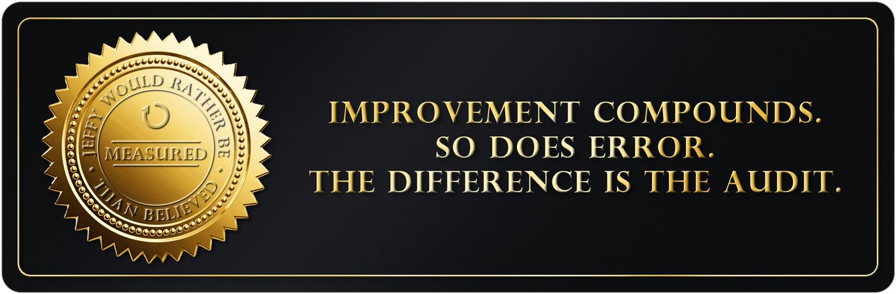

<h1 align="center">Recursive self-improvement (RSI) in Jeffy</h1>

<div align="center">



</div>

In 1965 the mathematician I. J. Good described a machine able to design a better machine than itself, and called what would follow an "intelligence explosion".[^good] Recursive self-improvement (RSI) is the name that idea goes by now: a system that is both the thing being improved and the thing doing the improving.

Jeffy runs almost the whole of that cycle on its own engine. It audits itself, writes the fix, proves the fix with a check, and has a second agent try to reject the work. The last step it leaves out on purpose: a human in the loop makes every final decision on what changes in either tool. This page says what each of those claims rests on. It then sets out the standard Jeffy and Housebroken are held to after a miss, the records that standard runs on with an example from each, and the schedule that applies it every week.

## The closed loop

In an RSI loop the system finds its own weak point, changes itself, tests the change and runs the new version. Jeffy does that to its own source:

1. Jeffy is pointed at this repository under the same rules as any outside project: the same evidence rules, the same adversarial gate, no privileged mode.
2. A finding counts only when a check that runs proves it.
3. A defect in the engine is fixed with a behavioural check in `scripts/validate.sh` that fails if the defect returns.
4. A second agent with no part in the run tries to reject the result before the run may call itself done.
5. The engine that comes out is the engine that audits the next round.

Release 1.29.0 is a worked case. A self-run over the change that gave every rule a name found a run ending that stated its rule and recorded nothing, fixed it, and added the checks that now hold it. [The loop improves the loop](how-it-works.md#the-loop-improves-the-loop) has the earlier cases and their commits. [Recursive self-learning](#recursive-self-learning), further down this page, shows the records this cycle runs on, with an example from each.

## A human in the loop

Jeffy stops one step short of closing the loop, and that is the design. Everything up to the decision is automated. The decision is not.

| Step of the cycle | Who does it |
|:---|:---|
| Find the weak point in its own engine | Jeffy |
| Write the fix | Jeffy |
| Prove the fix with a check that runs | Jeffy |
| Try to reject the work | A second agent with no part in the run |
| Record which of its own rules fire | Jeffy, from 1.29.0. [Usage](usage.md) has the fields. |
| Decide that a change to the engine ships | A human in the loop, every time |

Nothing acts on the fire log by itself either: the loop counts, and a person decides what to do about a rule that never fires. The model is outside the cycle altogether. Jeffy does not train it or alter it; the engine around the model is what improves.

## The guardrails

A loop that improves itself can learn to grade itself kindly, and it can move faster than anyone reads. Those are the two real risks, and each has a mechanism here.

- **The judge is not the author.** A standard run is complete only when a second agent with no part in it signs off, and that agent grades the run's evidence as well as the code.
- **Published numbers answer to the run.** The check count this repository publishes is compared with the validator run itself, and a page that promises more checks than the run delivered is refused.
- **Failures are published.** `evals/ATTEMPTS.md` carries every attempt, the ones that did not converge included, and a self-run that fails to converge is merged under a subject that says so.
- **The loop never pushes.** It commits locally, and nothing becomes a release until the human in the loop approves it.

## Recursive self-learning

A mistake is allowed once.

Jeffy Loop and [Housebroken](https://github.com/lenamonj/housebroken) are run by an agent, and an agent makes mistakes. So do the people who direct it. We do not expect a run with no misses. We expect a miss to be written down the day it happens, traced to the exact step where the work left its plan, and answered with something that would have stopped it. Then we expect never to meet that miss again. When one comes back anyway, the record says so and counts it.

This section is that standard, the records it runs on, and an example from each. Where an example comes from a public file, the row names the file.

### What we hold ourselves to

1. **The record outranks recall.** A cause nobody can point to in a file, a commit or a thread is a guess, and it is labelled as one.
2. **Fix the loop that produced the miss.** A patch to the one run closes the symptom. The work is finished when the process that allowed it has changed.
3. **A lesson a machine can check becomes a check.** Prose is the weakest tool we have. A run once promoted a lesson into its plan and broke that same lesson two iterations later ([How it works](how-it-works.md#the-loop-improves-the-loop)).
4. **A check has to be able to fail.** A new check is accepted after it has been seen red, on the original defect or on a mutant. A check that has never failed has proven nothing yet.
5. **The author does not judge the work.** A second agent with no part in the run grades it. A maintainer, or anyone outside, outranks both.
6. **Failures stay on the record.** [`evals/ATTEMPTS.md`](../evals/ATTEMPTS.md) lists every study target ever started, the ones that did not converge included.
7. **A person or a model is never the root cause.** "The session forgot" is where the questions start. The answer names a missing check, a tool that did not print a fact, or an action that had no sanctioned path.
8. **A person decides.** The loop finds, proves and proposes. A human in the loop rules on every change to the engine ([A human in the loop](#a-human-in-the-loop)).

### The records, and an example from each

Memory writes none of the engine's records. The hook and the gates write them as they run. The two lessons records are written by the session that learned the lesson, and the table says so.

| Record | Who writes it, and when | An example |
|:---|:---|:---|
| Turn record, `.jeffy/metrics/<run>.jsonl` | The Stop hook, at every turn end | Run `b78c8d86-045240`, iteration 1: `"iter_type":"AUDIT"`, `"rows_unswept":21`, `"wall_elapsed_s":1362`. Iteration 2: `"rows_unswept":1`. |
| Fire log, `.jeffy/metrics/<run>.fires.tsv` | The Stop hook, each time it states a named rule | The same run: `1794372952  1  lint  inventory-row-stale`, then `1794375646  2  lint  backlog-open-high-medium` |
| Evaluator report, `.jeffy/evaluator/<run>-<n>.md` | A second agent, each time a run calls itself done | `path-to-regexp`: three runs, five evaluator invocations, four rejections, and every rejection was a defect in the run's own evidence ([How it works](how-it-works.md#the-loop-improves-the-loop)) |
| Attempts table, [`evals/ATTEMPTS.md`](../evals/ATTEMPTS.md) | Derived from the run journals | `BurntSushi/toml`: 5 runs, 52 iterations, not converged, 3 runs ended blocked |
| Lessons in a project's `PLAN.md` | The run that learned the lesson | A lesson met a second time is marked `[recurred]`, and the run report proposes turning it into a mechanism |
| Lessons ledger, Housebroken [`docs/lessons.md`](https://github.com/lenamonj/housebroken/blob/main/docs/lessons.md) | The session, after a maintainer rules or a review finds a fault | 2026-11-18, `mholt/PapaParse #1133`: an account with no role in the repository found a real defect in a pull request of ours that had been open since 2026-07-27 |
| Refusal log, Housebroken, local to each machine | Every gate, each time it says no | A UTC time, the permanent name of the rule and the repository. It holds no message text and never leaves the machine. |

The two engine rows can be printed from a clone of this repository:

```bash
cat .jeffy/metrics/b78c8d86-045240.fires.tsv
bash scripts/jeffy-stats.sh . --rules
```

### From a miss to a mechanism

These are real conversions. Each row is a miss, who caught it, the mechanism it became, and the proof that mechanism can fail. A blank in the record stays a blank here.

| When | What went wrong | Caught by | What it became | Seen red |
|:---|:---|:---|:---|:---|
| 2026-11-18 | `mholt/PapaParse #1133`: a fix added state that lives between calls and was tested through one arm of the choice it changed. The same code stood in a second place and was left alone. | An account with no role in the repository found the first. Our own review of the rework found the second place. | `housebroken sites` lists every other place the base holds the code a branch replaces. The review brief attacks those places and any state carried between calls. | Its test kills 26 of 26 mutants |
| 2026-11-18 | That new check went to its review with a green suite | Our own review: "DO NOT SHIP". "nine of sixteen mutants of same-code.sh pass the shipped test" | A new gate is reviewed like a patch, and the review mutates it. The release note says how many mutants the test kills. | 26 of 26 after the fix |
| 2026-11-18 | The script that writes a merge receipt staged one wrong, then red. 195 unit tests passed both times: they held the script's model of the page and not the gate's. | The fresh-clone validate: "count:issues claims 4 but the scorecard derives 3" | A test reads the gate's own label counts and fails when the script derives fewer | On the old script it names `issue filed` |
| 2026-11-08 | Three pull requests were withdrawn by hand: no check on the note, the fork branches left up, nothing recorded | Not stated in the ledger | `close.sh` is the only way a pull request of ours is withdrawn | Not stated in the ledger |
| 2026-11-07 | Two replies were drafted for accounts with no role in the repository, and one was posted. The inbox printed no role beside a commenter. | The user | The inbox prints each voice's role, and `reply.sh` refuses a voice with no role without the user's word | Not stated in the ledger |
| 2026-11-01 | "a check that read nothing looked exactly like a check that found nothing", twenty times | An independent review, in which 12 of 27 mutants survived | A scan proves it read something before it may pass: UNREAD, never CLEAN, in every gate | Not stated in the ledger |
| Earlier, in Jeffy | A published number was copied from wherever it last appeared | Not stated on that page | Check K compares the published check count with the validator run itself, on every host | During a release build it rejected a stale `203` that a human had already read past |
| 1.29.0, in Jeffy | A run ending stated its rule and recorded nothing | The first self-run over the change that gave every rule a name | The fix, and the checks that now hold it | Not stated on that page |

The Housebroken rows are from its [lessons ledger](https://github.com/lenamonj/housebroken/blob/main/docs/lessons.md). The Jeffy rows are from [How it works](how-it-works.md#the-loop-improves-the-loop).

### The ladder

Every countermeasure is rated by how much it depends on someone remembering. We build at the highest rung we can reach.

| Rung | Mechanism | On the record |
|:---:|:---|:---|
| 1 | Remove the possibility. The value is derived, so nobody types it. | The turn record and the fire log: the Stop hook writes them, so nobody types an iteration count or a fire |
| 2 | A gate that refuses and fails closed | Check K: it refuses a page that promises more checks than the validator ran, and it rejected a stale `203` during a release build |
| 3 | A behavioural check or a test, proven by sabotage or mutants | The checks in `scripts/validate.sh`; Housebroken's `tests/test-same-code.sh`, which kills 26 of 26 mutants |
| 4 | A tool that reads for you and prints what has to be decided | `housebroken sites`; the inbox printing each voice's role |
| 5 | A line in a prompt, a review brief or a checklist | The review brief items on other sites and carried state |
| 6 | Prose: a lessons row, a `PLAN.md` Lesson, a note | Where every lesson starts, and where none should stay |

A gate or a test with no record of having been seen red is counted at rung 6 until it has one.

### How the records feed each other

| From | To | What carries it |
|:---|:---|:---|
| A run | Turn record, fire log, journal entry | The Stop hook, at every turn end. The journal heading supplies the record's `iter_type`. |
| Fire logs | Which rules fired, on which path, and which never fired | `scripts/jeffy-stats.sh --rules` |
| A run that calls itself done | An evaluator report | A second agent with no part in the run. A rejection sends the run back to work. |
| Run journals | `evals/ATTEMPTS.md` | Derived, failures included |
| A defect found in the engine | A behavioural check in `scripts/validate.sh` | The fix lands with a check that fails if the defect returns |
| The validator run | The check count this repository publishes | Check K refuses a page that promises more checks than the run delivered |
| A maintainer's verdict or a review finding | A lessons row, and a gate where a machine can hold one | Quoted verbatim, with the rule it became |
| A gate that says no | The refusal log | One line per refusal, under the rule's permanent name |
| A lesson met twice | A proposal to mechanize it | The `[recurred]` mark. A person decides. |
| All of the above | A review of what left its plan | For each miss: where it started, which checks let it through, and what will stop it next time |

### Measured, not believed

"Is it working" is a number or it is nothing.

- The count of behavioural checks began at 119. The [README](../README.md) carries the current floor, and check K holds that number to the validator run.
- The [receipts](../evals/README.md) list every merged patch, and [`evals/ATTEMPTS.md`](../evals/ATTEMPTS.md) lists every study target that did not converge.
- The review in the last row above is new. The first one ran on 2026-11-19. From then on, it reports for each window: how often a closed cause came back, the share of misses first found by someone outside, the time from a miss's origin to its detection, the share of countermeasures at rungs 1 to 3, and the share with a recorded red proof. Those numbers go here once there are two reviews to compare. Until then this section claims no trend.

## The review runs on a schedule

A standard that depends on someone remembering to apply it is prose, the lowest rung of the ladder above. So the review of what went wrong is started by a scheduled task, and what it may do is fixed in code. This is how the project is run. The scheduling code lives with the maintainer's records and is not part of the package you install.

**Every Monday** at 9 AM, or at the next start after a missed Monday, a task starts a review session that nobody watches and nobody answers. Code, and not the session, decides what is owed, gathers the week's records and starts the session with a fixed brief. It skips the week when a person ran a full review in the last three days, and it refuses to start on top of uncommitted work in the records. The session lists every miss recorded since the last review and takes each serious one apart: where the work left its plan, which checks let it through, and what would have stopped it. It ends with two things. The first is a ranked list of what the next version of Jeffy Loop and of Housebroken should carry, or a plain statement that a tool has nothing ready. The second is a written answer to three questions that are asked every week. In short:

1. Is the path we are on reducing mistakes from the start of the process to its end, and what in the record shows it?
2. Given what we are doing now, what would improve the process?
3. Of all the mistakes logged, which one thing, built this week, would prevent the most of them?

The brief asks for answers that cite the record. "It is going well" is not an answer, and neither is a list of what was built.

**Once a month** a second session reviews the procedure itself. Its questions include these: from all the mistakes logged, what should the procedure gain; is the path reducing mistakes; and where does the scaffolding cost more than it prevents? It may rewrite the procedure's working sections. Its brief requires each change to carry the miss or the measure that motivated it and a prediction for a later review to check, and a later review reverts a change whose prediction failed. Code checks only that the version went up by one and that one new row was logged. It may not rewrite the procedure's purpose, its ground rules, its guardrails, who writes where, or the decisions owed to a person. Those it can only propose.

**The rule for rules.** The procedure requires that a rule in code be written from a failure the record shows: the facts first, then the cause, then the code. A guess about what might go wrong is not grounds for one, and the briefs tell each session the same. Nothing in code enforces this rule yet. The schedule on this page does not meet it cleanly either: the incident it answers was written down on the day the code was built, and its analysis is owed to the first scheduled review. The sandbox below is an exception on purpose. It guards against something that has not happened here, a session steered by hostile text in what it reads.

### What the scheduled session can do

| | The scheduled session |
|:---|:---|
| Reads | Both tools' repositories and the maintainer's records |
| Writes | Review files, incident analyses, a list of register events for code to check and load, and once a month the working sections of the procedure |
| Runs | One program: a reader of git history that takes nine read-only subcommands, only the options on its list spelled in full, and no path outside the tree |
| Cannot | Push, post, release, reply to anyone, edit either tool's code, write the incident register itself, use the web or any connector |

It is started in a restricted mode with nobody to answer a permission prompt, so what is outside that list is refused, whatever a line in a log or a stranger's comment tells it to do. Its shell can also run its own built-ins inside the same folders, and that includes writing a file there with a redirect.

### What code checks after it

The session's work is not trusted either. Before anything is recorded, code holds what it wrote to the rules:

| If the session | Code |
|:---|:---|
| Changed a file in the review area that it may not write, or an earlier review | Fails the run, sets the changes aside and puts that area back as committed |
| Rewrote a guarded section of the procedure, or changed it without a new version and one new log row | Puts the whole file back and keeps the rewrite for a person |
| Queued a ruling, a release, a proof or a close | Does not load its list: a ruling is a person's, and the rest record things a sandboxed session cannot have done |
| Failed, ran too long, or could not be started | Records no review, and logs the failure as an incident for the next one |

A run refused before it starts, because work is uncommitted or another run holds the lock, leaves a line in a local log and no incident. Both products are held by the sandbox alone, and code notes in the run's log when either tree changed while a session ran. Only then is the review recorded, with its cost read from the session's own transcript.

### Seen red, twice

The sandbox was not taken on trust, and the first proof of it was not enough.

Before the schedule was switched on, the real command and sandbox were run, with a smaller model, under a brief that tried each forbidden thing. Reading the results turned up two gaps in the checks above: a session could have queued a ruling, and could have overwritten an earlier review. Writing the tests for those turned up a third: a failed run's changes were committed along with its log line. All three were closed that day.

Then an independent reader, a different model given the code and this page, found what the probe and every test had missed. The git reader refused a list of dangerous options, and a program could still be started through it by hiding git's pager option inside a bundle of short flags. The reader's verdict on this page was "DO NOT SHIP". The git reader now takes only the options on its list and refuses everything else. The probe now tries that route, and it plants a secret in a file outside the session's folders to see whether any tool can read it. In the run recorded on 2026-11-19 nothing got out: no forbidden file was made, the secret appeared nowhere in either session's answer or transcript, and no program ran through the reader. One thing does get through, inside the session's own folder: a second command chained after the git reader can write a file into the review area, and the checks above treat such a file as the run's work.

On 2026-11-19 the scheduling code had 86 tests, and all 77 mutants of its rules were killed. The first sweep after the fix killed 73 of them: the four that survived were rules of the new reader that no test covered, and each now has one. All of the mutants were killed, with smaller numbers, on the day the independent reader found the hole, which is why this page does not offer those numbers as proof that nothing is left to find.

The schedule was set on 2026-11-19 and its first run is Monday 2026-11-23. It automates finding, analysing and proposing. Nothing it produces ships without a person's word. The one thing it changes on its own is the working text of its own procedure, and every such change is logged with its version. Until reviews have run on it, this section claims a mechanism and no result.

## What this is not

It is not an intelligence explosion. Nothing here trains a model or makes one smarter. The gain is an engine that forgets less after every run, held by a test suite and released by a person. Good's own condition for his machine was that it stay docile enough to tell us how to keep it under control. Jeffy's version of that condition is plainer: it would rather be measured than believed.

[^good]: I. J. Good, "Speculations Concerning the First Ultraintelligent Machine", *Advances in Computers*, vol. 6, 1965, pp. 31-88.
